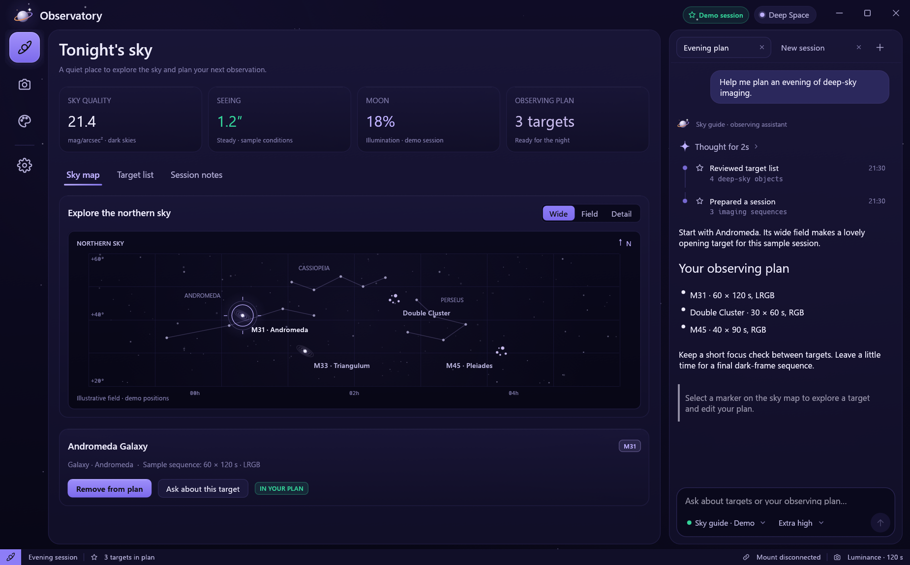
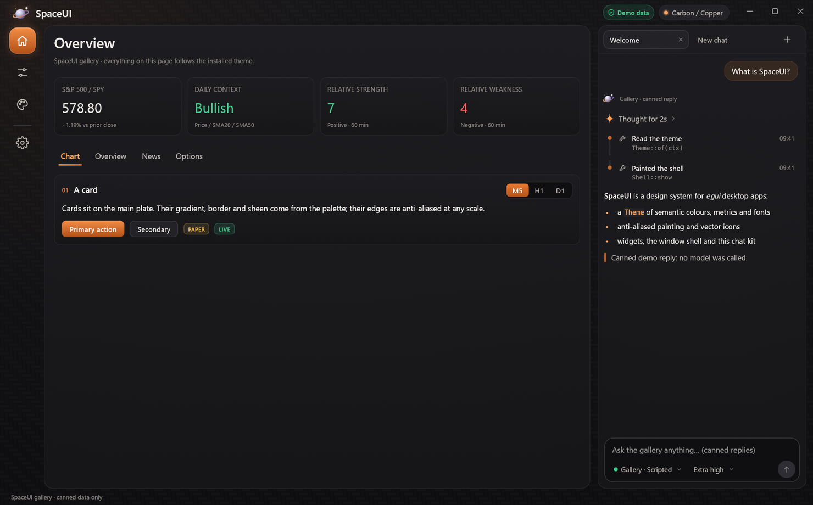
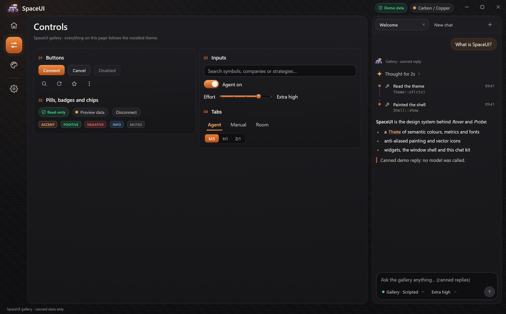
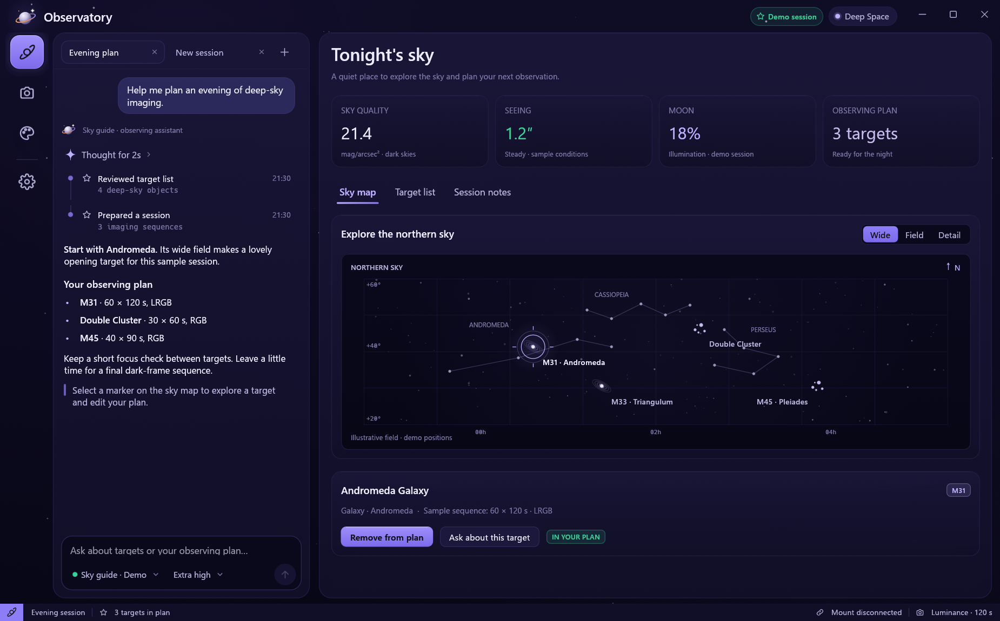
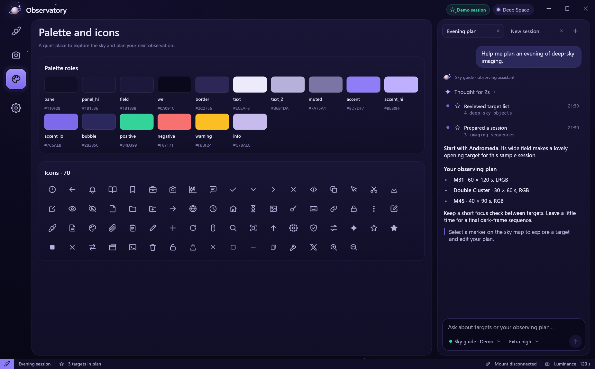

# SpaceUI

[](https://github.com/lero-aom/spaceui/actions/workflows/ci.yml)
[](#minimum-supported-rust-version)
[](https://github.com/lero-aom/spaceui/blob/v0.2.1/LICENSE)

A design system for [egui](https://github.com/emilk/egui) desktop apps: themes, anti-aliased painting, vector icons,
widgets, a custom-window shell and a chat kit. Install a theme, show the shell and fill its regions; every part also
works on its own.



## Highlights

- **One theme, everywhere.** A `Theme` is a semantic `Palette`, `Metrics`, fonts and a `Backdrop`. Install it once;
  every widget reads it back, so nothing hard-codes a colour. Two ship: *Carbon / Copper* and *Deep Space*.
- **Smooth at any scale.** Gradients and fills get the same one-pixel feathered edge egui gives its own shapes. Icons
  and logos stay SVG and are rasterized at the exact pixel size they're drawn at.
- **A whole window, your layout.** Your own title bar (usable even above modal dialogs), an optional icon rail, a
  carded main panel, resizable columns on the left, the right or both, a status line and window resize edges, in one
  builder.
- **A chat kit.** Conversation tabs, user bubbles, Markdown replies, collapsible thinking, a tool-call timeline, starters
  for an empty chat and a composer with model and effort dropdowns. It draws into any rectangle: a column on either
  side, the main card, a window. Your app keeps the conversations and the backend.
- **Plain data, composable controls.** Use simple widget helpers or configurable `egui::Widget` builders;
  themes remain ordinary structs. There is no framework to adopt.



## Getting started

```toml
[dependencies]
spaceui = "0.2.1"
eframe = "0.37"
```

A small observatory with a sky view, a target catalog and an observation-plan column
([`examples/minimal.rs`](https://github.com/lero-aom/spaceui/blob/v0.2.1/examples/minimal.rs)):

```rust,no_run
use spaceui::egui;
use spaceui::prelude::*;

const RAIL: &[RailItem<'static>] = &[
    RailItem::page(Icon::Orbit, "Sky"),
    RailItem::page(Icon::Star, "Targets"),
    RailItem::Divider,
    RailItem::page(Icon::Settings, "Settings"),
];

#[derive(Default)]
struct App {
    page: usize,
    side: f32,
    queued: bool,
}

impl eframe::App for App {
    fn ui(&mut self, ui: &mut egui::Ui, _frame: &mut eframe::Frame) {
        let regions = Shell::new("Observatory")
            .logo(Icon::Orbit.svg())
            .rail(RAIL)
            .right_column(&mut self.side, 320.0..=560.0)
            .show(ui, &mut self.page);

        ui.scope_builder(egui::UiBuilder::new().max_rect(regions.main), |ui| {
            ui.heading(["Sky", "Targets", "Settings"][self.page]);
            widgets::caption(ui, "Demo observing session · sample data only");
            match self.page {
                0 => {
                    ui.label("M31 · Andromeda Galaxy");
                    if widgets::primary(ui, "Add M31 to plan").clicked() {
                        self.queued = true;
                    }
                }
                1 => {
                    for target in ["M31 · Andromeda Galaxy", "M42 · Orion Nebula", "M45 · Pleiades"] {
                        ui.label(target);
                    }
                }
                _ => {
                    ui.label("Deep Space theme · no telescope connected");
                }
            }
        });
        if let Some(plan) = regions.right {
            ui.scope_builder(egui::UiBuilder::new().max_rect(plan.shrink(18.0)), |ui| {
                ui.heading("Observation plan");
                ui.label(if self.queued { "01 · M31 · Andromeda Galaxy" } else { "Add a target from the sky view." });
            });
        }
    }
}

fn main() -> eframe::Result {
    let options = eframe::NativeOptions {
        // Undecorated: the shell draws the title bar and the resize edges.
        viewport: window::viewport("Observatory", "spaceui-observatory"),
        ..Default::default()
    };
    eframe::run_native(
        "Observatory",
        options,
        Box::new(|cc| {
            let theme = Theme::deep_space();
            window::round_corners(cc, theme.palette.border);
            theme.install(&cc.egui_ctx);
            Ok(Box::new(App::default()))
        }),
    )
}
```

SpaceUI re-exports egui as `spaceui::egui`, so your app and SpaceUI always agree on its version.

## Features

The default enables the complete desktop kit. For themes, painting and basic widgets only:

```toml
spaceui = { version = "0.2.1", default-features = false }
```

| Feature | Adds |
|---|---|
| `svg` | SVG art, icons and controls that use them; enables `resvg` |
| `shell` | The window shell and rail; enables `svg` |
| `chat` | Chat components and CommonMark rendering via `egui_commonmark`; enables `svg` |
| `native` | Native window-handle integration; enables `raw-window-handle` |
| `screenshot` | PNG screenshot runs; enables `svg` |

Version 0.2 uses `egui_commonmark` and accepts runtime SVG sources and rail labels.
See [the migration notes](https://github.com/lero-aom/spaceui/blob/v0.2.1/CHANGELOG.md#020---2026-11-05)
before upgrading from 0.1.

All five are enabled by default. For example, `default-features = false, features = ["chat"]` adds the
chat kit without native window integration. Use `cargo doc --no-deps --no-default-features` to see the
core API, or `cargo doc --no-deps --all-features` for everything. See the
[integration guide](https://github.com/lero-aom/spaceui/blob/v0.2.1/docs/integration.md) for composition, accessibility and known limits.

## Examples

| Example | Shows |
|---|---|
| [`minimal`](https://github.com/lero-aom/spaceui/blob/v0.2.1/examples/minimal.rs) | The observatory above: sky, targets and an observation plan |
| [`custom_theme`](https://github.com/lero-aom/spaceui/blob/v0.2.1/examples/custom_theme.rs) | An astronomy app with a cool moonlit palette |
| [`gallery`](https://github.com/lero-aom/spaceui/blob/v0.2.1/examples/gallery.rs) | An observing dashboard, instrument controls, palette and icons, and a scripted assistant |

The examples use fixed illustrative targets and session data. They do not calculate live sky positions,
connect to equipment or call an AI service.

```sh
cargo run --example gallery
```



## Organisation

The modules build on each other, from colours to whole windows. `cargo doc --open` shows the full API with examples.


| Module | Holds |
|---|---|
| [`theme`](https://github.com/lero-aom/spaceui/blob/v0.2.1/src/theme/mod.rs) | `Theme`, `Palette`, `Metrics`, `Fonts`, `Backdrop`, and the font helpers `regular`, `semibold`, `mono` |
| [`paint`](https://github.com/lero-aom/spaceui/blob/v0.2.1/src/paint.rs) | Anti-aliased gradients, polygon fills, glows and a sparkle glyph |
| [`art`](https://github.com/lero-aom/spaceui/blob/v0.2.1/src/art/mod.rs) | The built-in `Icon` set (70 line icons) and your own `Svg` art, with window icons |
| [`widgets`](https://github.com/lero-aom/spaceui/blob/v0.2.1/src/widgets/mod.rs) | Buttons, pills, badges, chips, tabs, segmented controls, cards, metrics, a switch, a field, a slider, and the `Tone` they take |
| [`shell`](https://github.com/lero-aom/spaceui/blob/v0.2.1/src/shell/mod.rs) | The `Shell` builder (rail, left and right columns, status line), `RailItem` and the `Regions` it returns |
| [`chat`](https://github.com/lero-aom/spaceui/blob/v0.2.1/src/chat/mod.rs) | `ChatLayout`, `tab_strip`, transcript pieces, `Composer` and a Markdown renderer |
| [`window`](https://github.com/lero-aom/spaceui/blob/v0.2.1/src/window.rs) | An undecorated viewport, rounded corners on Windows 11 and screenshot runs |

## Layout

Only the title bar and the main card are always there. Add what you need:

```rust,no_run
# use spaceui::{Icon, RailItem, Shell};
# fn ui(ui: &mut spaceui::egui::Ui, page: &mut usize, chat: &mut f32, outline: &mut f32) {
# const RAIL: &[RailItem<'static>] = &[RailItem::page(Icon::Orbit, "Sky")];
let regions = Shell::new("Observatory")
    .rail(RAIL)                               // optional; without it the cards take the space
    .left_column(outline, 240.0..=400.0)      // optional
    .right_column(chat, 320.0..=560.0)        // optional
    .status_bar(22.0)                         // optional
    .show(ui, page);
// regions.main, regions.left, regions.right and regions.status are yours to fill.
# }
```



## Your own theme

A theme is plain data: start from a built-in one and change what you need
([`examples/custom_theme.rs`](https://github.com/lero-aom/spaceui/blob/v0.2.1/examples/custom_theme.rs)).

```rust
use spaceui::egui::Color32;
use spaceui::{Backdrop, Palette, Theme};

let lunar = Theme {
    name: "Lunar",
    palette: Palette {
        accent: Color32::from_rgb(125, 211, 252),
        accent_hi: Color32::from_rgb(186, 230, 253),
        accent_lo: Color32::from_rgb(82, 160, 220),
        bubble: Color32::from_rgb(28, 44, 78),
        ..Palette::DEEP_SPACE
    },
    backdrop: Backdrop::Starfield,
    ..Theme::deep_space()
};
assert_eq!(lunar.metrics, Theme::deep_space().metrics);
```

Fonts are part of the theme too: Segoe UI from the system by default, egui's bundled fonts with `Fonts::BUNDLED`, or
your own files:

```rust
use spaceui::theme::{FontFile, Fonts};

# const INTER_REGULAR: &[u8] = &[];
# const INTER_SEMIBOLD: &[u8] = &[];
let fonts = Fonts {
    regular: Some(FontFile::from_static("Inter", INTER_REGULAR)), // e.g. include_bytes!("Inter-Regular.ttf")
    semibold: Some(FontFile::from_static("Inter Semibold", INTER_SEMIBOLD)),
    ..Fonts::SYSTEM
};
# let _ = fonts;
```

For a one-off colour, status widgets take `Tone::Custom(color)` next to the palette's tones.



## Configuring controls

The existing `widgets::primary`, `secondary`, `tabs`, and `segmented` helpers remain available.
Use `widgets::Button` with `ui.add` when an individual button needs different sizing or colours:

```rust
use spaceui::{egui, widgets};
let ctx = egui::Context::default();
ctx.run_ui(Default::default(), |ui| {
    let button = widgets::Button::primary("Connect")
        .min_size(egui::vec2(120.0, 40.0))
        .padding(egui::vec2(18.0, 10.0));
    let _response = ui.add_enabled(true, button);
    let mut selected = 0;
    let tabs = widgets::tabs_response(ui, &mut selected, &["Overview", "History"]);
    if tabs.response.changed() { /* switch views */ }
    tabs.response.on_hover_text("Choose a view");
}).drop_without_applying_deltas();
```

`tabs_response` and `segmented_response` return a `ChoiceResponse`: `.response` aggregates bounds,
hover and click flags, while `.choices` retains each choice's focus and accessible identity.
`changed()` reports a selection change, including index clamping. Clicking an already-selected choice
reports a click without a change. The original boolean helpers return the same change flag.

Install `theme::ControlMetrics` to configure minimum sizes and text padding for buttons, tabs,
segments and text fields across a context. Radii remain in `Theme::metrics`; colours and fonts
retain their existing sources. Per-button overrides take precedence over installed control metrics.

For chat, install `chat::ComposerMetrics` or pass `.metrics(...)` to one composer. It configures
text size, growth limit, padding, accessory-row height, button size and corner radius. Measure a
configured builder with `.desired_height(ui, width)` before calling `.show(...)`;
`Composer::measure` uses context defaults. Both metrics installations survive theme changes;
install their `Default` values to reset them. Defaults preserve the existing appearance.

## Checking your UI

`window::Screenshot` renders a few frames, saves the window as a PNG and closes the app, for native visual checks of
pages and themes. The gallery wires it to environment variables:

```sh
SPACEUI_SCREENSHOT=out.png SPACEUI_THEME=deep_space SPACEUI_PAGE=2 cargo run --example gallery
```

The gallery opens in Deep Space. To capture the observing dashboard in both built-in themes:

```sh
SPACEUI_SCREENSHOT=deep-space.png SPACEUI_THEME=deep_space cargo run --example gallery
SPACEUI_SCREENSHOT=carbon-copper.png SPACEUI_THEME=carbon_copper cargo run --example gallery
```

SpaceUI's own tests drive the widgets headlessly with simulated clicks and key presses; see [`tests/`](https://github.com/lero-aom/spaceui/tree/v0.2.1/tests).
Rendered snapshots cover representative layouts in both themes, and `cargo bench --bench workloads`
measures representative CPU workloads. See [CONTRIBUTING.md](https://github.com/lero-aom/spaceui/blob/v0.2.1/CONTRIBUTING.md) for checks and snapshot review.

## Platform support

SpaceUI targets desktop egui applications. CI is configured to compile and run headless tests on Windows,
Linux and macOS, on stable Rust and the MSRV. Rendered regression tests run separately on Linux with a
software Vulkan renderer. These checks do not exercise native window-manager behavior or screen readers.
Browser/WASM, mobile, other architectures and OS versions are not currently covered; egui support alone
does not establish SpaceUI support. See the [support matrix](https://github.com/lero-aom/spaceui/blob/v0.2.1/docs/support.md).

- **Fonts.** On Windows, Segoe UI, Segoe UI Semibold, Segoe UI Symbol and Segoe UI Emoji are read from the system at
  runtime, never bundled. Elsewhere egui's bundled fonts stand in under the same family names.
- **Window corners.** `window::round_corners` asks Windows 11 for rounded, anti-aliased corners and a border colour;
  other systems keep their defaults.
- **Window.** The shell expects an undecorated viewport (`window::viewport`).

## Minimum supported Rust version

SpaceUI's MSRV is 1.95, the minimum of egui 0.37. It is raised only in minor releases, and only when the egui version
SpaceUI builds on requires it.

The API is pre-1.0. Patch releases preserve the supported public API; breaking changes require a minor release
and migration notes. See the [compatibility and release policy](https://github.com/lero-aom/spaceui/blob/v0.2.1/docs/releases.md).

## Contributing

Contributions are welcome; [CONTRIBUTING.md](https://github.com/lero-aom/spaceui/blob/v0.2.1/CONTRIBUTING.md) explains the checks, the design rules and how to add
an icon.
Report ordinary bugs through [GitHub issues](https://github.com/lero-aom/spaceui/issues); follow
[SECURITY.md](https://github.com/lero-aom/spaceui/blob/v0.2.1/SECURITY.md) for potential vulnerabilities.

## License

SpaceUI is licensed under the [Apache License, Version 2.0](https://github.com/lero-aom/spaceui/blob/v0.2.1/LICENSE). Third-party notices are in
[NOTICE.md](https://github.com/lero-aom/spaceui/blob/v0.2.1/NOTICE.md).

Unless you explicitly state otherwise, any contribution intentionally submitted for inclusion in SpaceUI by you, as
defined in the Apache-2.0 license, shall be licensed as above, without any additional terms or conditions.
